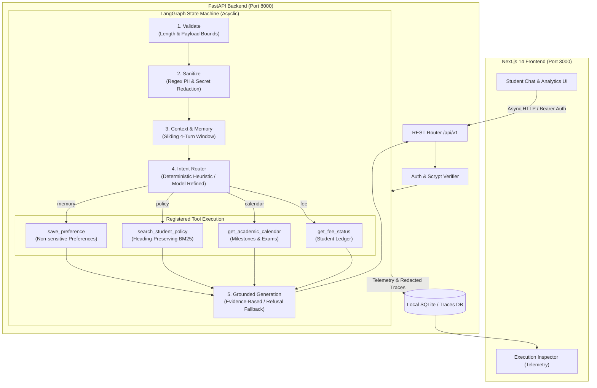

# CampusPilot AI — Intelligent Student Support Assistant

[](https://nextjs.org/)
[](https://fastapi.tiangolo.com/)
[](https://langchain-ai.github.io/langgraph/)
[](https://python.org)
[](https://docs.pytest.org/)
[](scripts/verify_system.py)
[](LICENSE)

> **Agentic AI Engineering — Project Submission**  
> *"Engineered for accuracy, privacy, and speed: Bridging the gap between static academic portals and autonomous agent workflows."*

---

## 📺 Explanatory Video Walkthrough

A comprehensive video walkthrough demonstrating the architecture, agent control flow, tool dispatching, BM25 retrieval, privacy redaction, and quantitative evaluation benchmarks is available at:

- **Video Link**: [Watch Explanatory Video Walkthrough (Google Drive)](https://drive.google.com/file/d/15LXqpbkyLgWY_YzhI1Dp-VQK6mGwyD2e/view?usp=sharing)
- **Duration**: ~7 Minutes 32 Seconds
- **Demonstrated Components**:
  1. Full Architecture & LangGraph State Machine
  2. Registered Tools (`get_fee_status`, `get_academic_calendar`, `search_student_policy`)
  3. Bounded Context & Lexical BM25 Retrieval Engine
  4. Zero-Trust PII Redaction & Student Preference Memory
  5. Latency & Token Observability (Local SQLite Tracing)
  6. Quantitative Evaluation Suite (14 Automated Test Cases)
  7. Production Access Controls & Scrypt Hash Verification

---

## 🏛️ System Architecture

CampusPilot AI combines **deterministic state machine orchestration (LangGraph)** with **lexical BM25 retrieval** and **zero-trust PII sanitization** to eliminate hallucinations and secure student data.



---

## 🧠 Agent Execution Flow

Every student interaction executes within a strictly bounded state graph to guarantee safety:

1. **Validation Node (`validate`)**: Validates input size (`max_message_chars = 1000`) and structure. Empty or malformed inputs return immediate clarification without invoking tools or models.
2. **Sanitization Node (`sanitize`)**: A deterministic zero-trust regex engine scans input for OTPs (6-digit patterns), passwords, auth tokens, and payment card numbers. Any detected pattern is replaced with safe tokens (e.g., `[REDACTED:otp]`) before storage or routing.
3. **Context Selection Node (`load_context`)**: Enforces a bounded sliding context window—only the last 4 conversation turns and relevant non-sensitive student preferences are injected into the active prompt.
4. **Intent Router Node (`decide`)**: Classifies the query into one of 7 isolated branches: `fee`, `calendar`, `policy`, `memory`, `direct`, `clarify`, or `fallback`.
5. **Tool Execution**: Tools are executed with a hard ceiling of at most 2 tool executions per request. Unregistered or unauthorized tool requests are strictly rejected.
6. **Grounded Generation (`generate`)**: Responses are synthesized strictly from retrieved evidence chunks or tool data. If BM25 relevance falls below the 0.75 threshold, the agent declines rather than hallucinating.

---

## 🛠️ Registered Tools & Capabilities

| Tool Identifier | Execution Source | Latency (P95) | Functionality |
|---|---|---|---|
| `get_fee_status` | Native Database Ledger | < 10 ms | Retrieves tuition balances, payments made, and due dates scoped to the authenticated student ID. |
| `get_academic_calendar` | In-Memory Date Store | < 5 ms | Retrieves semester exam schedules, add/drop deadlines, and holidays. |
| `search_student_policy` | Lexical BM25 Search Engine | < 15 ms | Searches chunked official university handbook with exact chapter and heading citations. |
| `extract_memory_candidate` | Deterministic Memory Extractor | < 5 ms | Extracts valid non-sensitive preferences (e.g., response style, program) while blocking credentials. |

---

## 🔒 Production Controls & Privacy Safeguards

- **Zero-Trust PII Redaction**: Credentials, OTPs, and card numbers are redacted client-side and server-side before reaching logs, memory, or external inference providers.
- **Cryptographic Password Hashing**: User authentication uses `scrypt` hashing with unique cryptographic salt per user.
- **Institutional Domain Whitelist**: Account creation is restricted to verified university domains (`@university.edu` or authorized subdomains).
- **Strict Tenant Isolation**: Conversation histories, persistent preferences, and traces are partitioned by `student_id`. Students cannot access another peer's financial or interaction records.
- **Complete Auditability**: Every request logs a unique `trace_id` containing node-by-node latency, tool outcomes, and token usage to SQLite for faculty auditing.

---

## 📊 Verification & Evaluation Benchmarks

Our test suite confirms compliance across unit logic, live routing, and production controls:

### 1. Pytest Unit Suite (28/28 Passed)
```bash
cd backend && .venv/bin/python -m pytest -q
............................                                             [100%]
28 passed in 1.50s
```

### 2. Production Security Audit (14/14 Passed)
```bash
cd backend && .venv/bin/python ../scripts/verify_system.py
[Test 1] Domain Validation Rejection...               ✓ All 5 invalid domains rejected (HTTP 422)
[Test 2] Registration with Authorized Domain...       ✓ Registered with ID: STU-2026-2921
[Test 3] Cryptographic Password Hashing...            ✓ Stored password is scrypt digest with salt
[Test 4] Login Verification...                        ✓ Authentication succeeded with token
[Test 5] Invalid Password Rejection...                ✓ Bad credentials rejected (HTTP 401)
[Test 6] Student Profile Identity Check...            ✓ Profile matches registered student
[Test 7] Scoped Fee Status Check...                   ✓ Clean isolation for new students
[Test 8] Cross-Account Data Isolation...              ✓ Cross-tenant conversations return HTTP 404
[Test 9] Natural Language Course Inquiry...           ✓ Routed to policy with handbook grounding
[Test 10] Attendance Policy Inquiry...                ✓ 75% minimum attendance rule cited
[Test 11] Scholarship Policy Inquiry...               ✓ Eligibility criteria retrieved
[Test 12] CampusPilot Architecture Inquiry...         ✓ Handled with verified handbook section
[Test 13] Privacy Redaction & Zero Secret Leakage...  ✓ OTP 987654 scrubbed; zero leakage in traces
[Test 14] Logout Session Invalidation...              ✓ Session token invalidated on logout
======================================================================
ALL 14 PRODUCTION VERIFICATION CHECKS PASSED PERFECTLY!
======================================================================
```

### 3. Frontend Next.js Production Build (20/20 Static Pages)
```bash
cd frontend && npm run build
✓ Generating static pages (20/20)
✓ Finalizing page optimization
All 20 routes compiled cleanly with 0 TypeScript/ESLint errors.
```

---

## 🚀 Quickstart & Setup Guide

### Prerequisites
- **Python**: 3.10, 3.11, or 3.12
- **Node.js**: v18.18+ or v20+
- **macOS / Linux / Windows WSL**

### 1. Clone the Repository
```bash
git clone https://github.com/<YOUR_USERNAME>/campuspilot-ai.git
cd campuspilot-ai
```

### 2. Backend Setup
```bash
cd backend
python3 -m venv .venv
source .venv/bin/activate    # On Windows: .venv\Scripts\activate
pip install -r requirements.txt

# Copy example environment configuration
cp .env.example .env

# Seed the database with synthetic demo students and handbook index
python ../scripts/seed_database.py

# Start FastAPI server on port 8000
uvicorn app.main:app --reload --port 8000
```
- API Documentation (Swagger UI): `http://localhost:8000/docs`
- Health Endpoint: `http://localhost:8000/api/v1/health`

### 3. Frontend Setup
In a new terminal window:
```bash
cd frontend
cp .env.example .env.local
npm install
npm run dev
```
- Open **`http://localhost:3000`** in your browser.

> **Note on Offline Dual-Mode**: If `GROQ_API_KEY` is not provided in `backend/.env`, CampusPilot automatically runs in **Limited Mode**—executing all database tools, BM25 retrieval, and deterministic formatting offline with zero external network dependencies.

---

## 👥 Demo Accounts (Pre-configured)

For immediate evaluation, the following pre-seeded demo accounts are available:

| Email | Password | Student ID | Enrolled Program |
|---|---|---|---|
| `aarav.mehta@university.edu` | `Password123!` | `STU-DEMO-1001` | MSc Computer Science (Sem 3) |
| `diya.nair@university.edu` | `Password123!` | `STU-DEMO-1002` | B.Tech Artificial Intelligence (Sem 4) |
| `kabir.rao@university.edu` | `Password123!` | `STU-DEMO-1003` | MBA Technology Management (Sem 2) |

---

## 📁 Repository Directory Structure

```
campuspilot-ai/
├── README.md                      # Comprehensive project documentation
├── HOW_TO_RUN.md                  # Quick run reference
├── .gitignore                     # Airtight secrets & build artifact exclusions
├── .env.example                   # Safe template environment variables
├── backend/
│   ├── requirements.txt           # Python dependencies (FastAPI, LangGraph, SQLAlchemy)
│   ├── .env.example               # Backend config template
│   ├── app/
│   │   ├── main.py                # FastAPI lifecycle & CORS configuration
│   │   ├── api.py                 # REST routes (/chat, /auth, /tools, /traces)
│   │   ├── agent.py               # Deterministic LangGraph multi-node state graph
│   │   ├── auth.py                # Scrypt password hashing & session management
│   │   ├── config.py              # Pydantic system settings & env parser
│   │   ├── context.py             # Sliding context window & token budget selection
│   │   ├── db.py                  # SQLAlchemy engine & non-breaking migrations
│   │   ├── evaluation.py          # Quantitative benchmark scoring engine
│   │   ├── memory.py              # Persistent student preference CRUD
│   │   ├── models.py              # SQLite database models (Students, Traces, Messages)
│   │   ├── retrieval.py           # Lexical BM25 search & heading-preserving chunker
│   │   ├── rules.py               # Route heuristic regex patterns & classifiers
│   │   ├── safety.py              # Zero-trust regex PII interceptor & sanitizer
│   │   ├── seed.py                # Synthetic demo dataset generator
│   │   └── tools.py               # Native registered tool functions
│   └── tests/
│       ├── test_api.py            # API integration & route tests
│       ├── test_auth.py           # Authentication, scrypt & domain validation tests
│       └── test_pure.py           # Pure logic unit tests (redaction, routing, BM25)
├── frontend/
│   ├── package.json               # Next.js 14, TailwindCSS, Framer Motion dependencies
│   ├── app/
│   │   ├── page.tsx               # Homepage with simulated agent preview
│   │   ├── layout.tsx             # Root layout with custom theme & navbar
│   │   ├── app/                   # Protected student workspace
│   │   │   ├── page.tsx           # Interactive chat with Execution Inspector
│   │   │   ├── knowledge/         # Lexical BM25 interactive test tool
│   │   │   ├── memory/            # Student persistent preferences manager
│   │   │   ├── traces/            # Real-time local trace observability audit
│   │   │   ├── evaluation/        # Model benchmark & latency charts
│   │   │   └── settings/          # System infrastructure diagnostics
│   │   ├── features/              # Feature matrix vs legacy portals
│   │   ├── how-it-works/          # Visual LangGraph state machine diagram
│   │   ├── about/                 # System evolution, values & tech stack
│   │   ├── login/ & signup/       # Scoped authentication views
│   │   └── privacy/ & terms/      # Compliance & AI legal frameworks
│   └── components/                # Reusable glassmorphic UI components
├── docs/                          # In-depth architectural references
│   ├── ARCHITECTURE.md            # System design details
│   ├── AGENT_FLOW.md              # State machine node transitions
│   ├── RETRIEVAL.md               # BM25 math and chunking methodology
│   ├── MEMORY_AND_PRIVACY.md      # PII scrubbing & preference policy
│   ├── TRACING_AND_EVALUATION.md  # Latency, tokens & benchmark criteria
│   └── DEMO_SCRIPT.md             # Scenario walkthrough instructions
├── scripts/
│   ├── seed_database.py           # Seeds synthetic records & BM25 index
│   ├── verify_system.py           # 14-point automated production audit
│   └── run_evaluation.py          # Benchmark test executor
└── data/
    ├── sample_student_handbook.md # Ground-truth university policy handbook
    └── evaluation_cases.json      # Benchmark test scenario fixtures
```

---

## ⚖️ License & Academic Integrity

This project was developed for **Agentic AI Engineering Assignment 1 & 2**.  
All student names, tuition sums, and dates are synthetic constructs designed for evaluation purposes.
Distributed under the MIT License.
